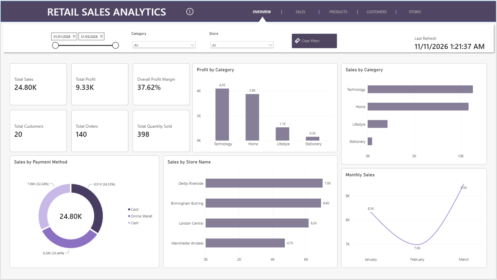
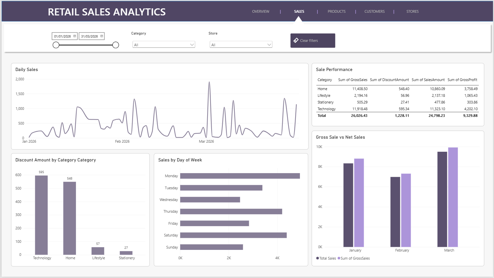
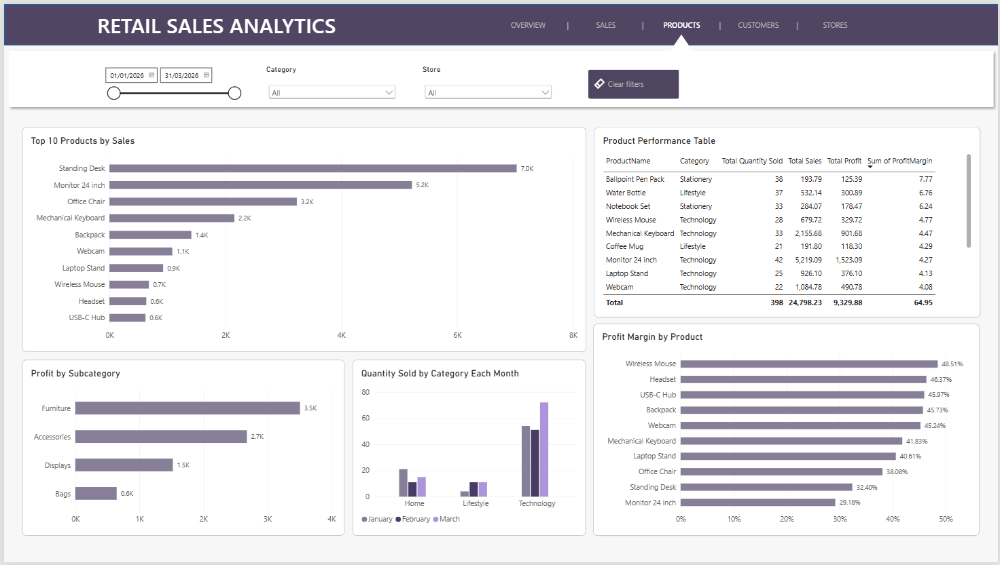
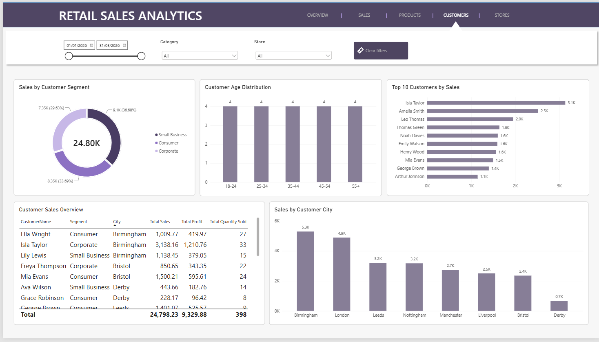
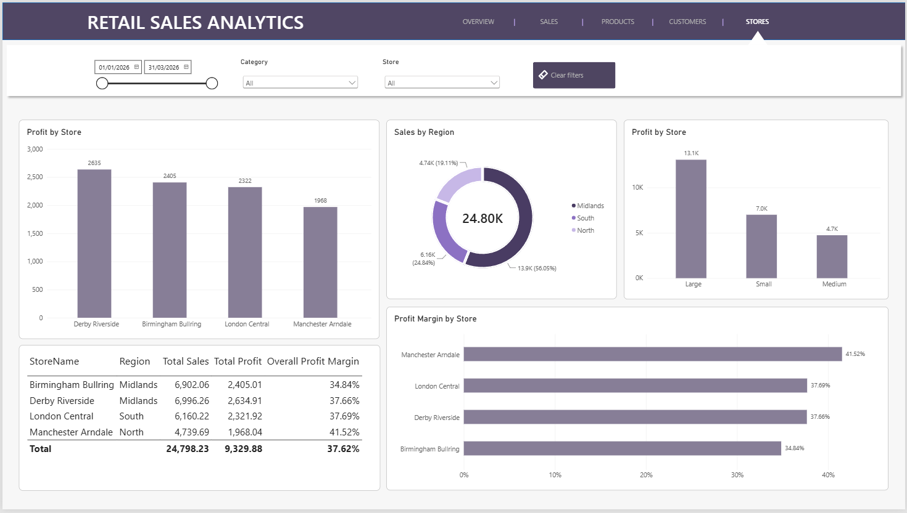

# Retail Sales Dashboard (Power BI)

An interactive five-page Power BI report analysing retail sales across products, customers and stores for January to March 2026.

## Question it answers
[One line in your words, e.g. "Which products, stores and customer groups drive the most sales and profit, and how do sales change over time?"]

## Data
- Source: retail sales dataset
- Size: 140 sales records, 20 customers, three months (Jan-Mar 2026)
- Tables in the model: Sales, Product, Store, Customer, Date
- [Add where the data came from, e.g. "sample dataset provided for coursework" or "dataset I created"]

## Report pages
| Page | What it shows |
|---|---|
| **Overview** | KPI cards (total sales, total profit, quantity sold, customers, orders, profit margin), sales trend over time, sales by store and category, profit by category, sales by payment method |
| **Sales** | Gross sales, discounts and gross profit, with trends by month and day of week, and a breakdown by category and store |
| **Products** | Product, category and subcategory performance, including quantity sold and profit margin |
| **Customers** | Customer segments, age bands, cities and payment methods |
| **Stores** | Store performance by region and store size, with sales and profit breakdowns |

## Features
- Slicers on every page to filter by date, category, store and more
- Navigation buttons between pages
- An "About this dashboard" information panel (shown and hidden with bookmarks) explaining the calculations and data
- Custom DAX measures including Total Sales, Total Profit, Total Quantity Sold, Total Orders, Total Customers and Overall Profit Margin

## Calculations
- Gross Sales = quantity sold x original selling price
- Discount Amount = gross sales x discount rate
- Net Sales = gross sales - discounts
- Total Profit = net sales - product costs
- Profit Margin = (total profit / net sales) x 100
- Average Order Value = total sales / number of orders

## Key insights
- [Insight 1 from your dashboard, with a number, e.g. "Category X generated Y% of total sales"]
- [Insight 2, e.g. the store, product or month that stood out]
- [Insight 3]

## Screenshots

## Skills shown
Data modelling, DAX measures, data visualisation, interactive filtering and navigation, dashboard design

## How to open
