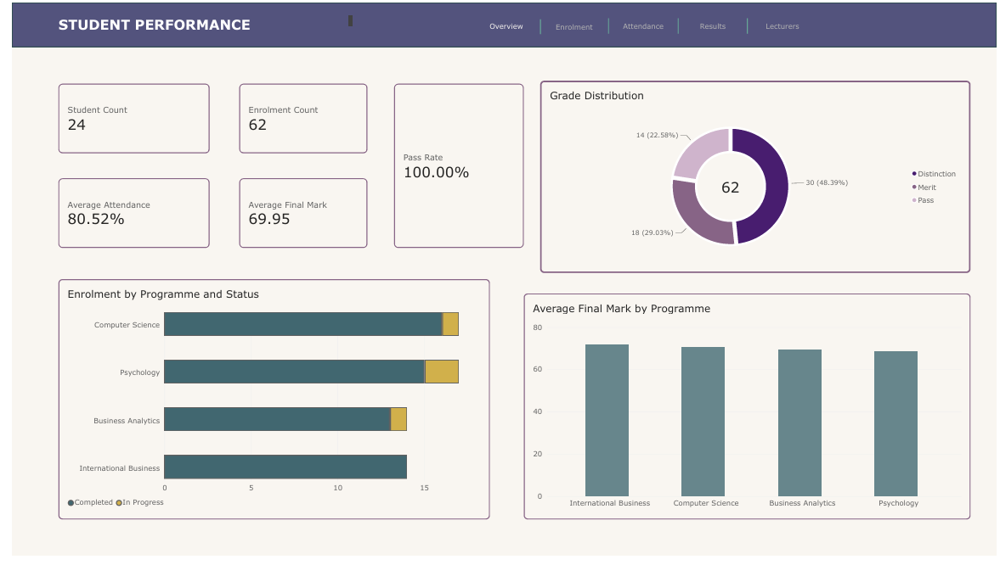

| # | Dashboard | Topic | Pages |
|---|---|---|---|
| 1 | [Retail Sales Dashboard](#1-retail-sales-dashboard) | Sales, profit, products, customers and stores | 5 |
| 2 | [Student Performance Analytics](#2-student-performance-analytics) | Enrolment, attendance, results and lecturers | 5 |

Files: the `.pbix` reports are in the `pbix` folder (open in Power BI Desktop, Windows). Screenshots are in `images`.

---

## 1. Retail Sales Dashboard

**Question it answers:** Which products, stores and customer groups drive the most sales and profit, and how do sales change over time?

**Data:** sample retail sales dataset (140 sales records, 20 customers, Jan-Mar 2026)
**Model tables:** Sales, Product, Store, Customer, Date

| Page | What it shows |
|---|---|
| Overview | KPI cards (sales, profit, quantity, customers, orders, profit margin), sales trend, sales by store and category, profit by category, sales by payment method |
| Sales | Gross sales, discounts and gross profit by month and day of week, with category and store breakdowns |
| Products | Product, category and subcategory performance, including quantity sold and profit margin |
| Customers | Customer segments, age bands, cities and payment methods |
| Stores | Store performance by region and store size |

**Features:** slicers on every page, page navigation buttons, and an "About this dashboard" panel (bookmarks) explaining the calculations.
**DAX measures:** Total Sales, Total Profit, Total Quantity Sold, Total Orders, Total Customers, Overall Profit Margin

**Key insights**
- Technology (11.3K) and Home (10.9K) generated about 89% of the 24.8K total sales and about 85% of the 9.3K profit, while Stationery contributed under 2% of sales
- Sales dipped to 7.0K in February, then rose to 9.5K in March (about 36% higher than February); Mondays were the strongest day of the week and Wednesdays the weakest
- Derby Riverside had the highest sales (7.0K) and profit (2.6K), while Manchester Arndale had the lowest sales (4.7K) but the best profit margin (41.52% vs 37.62% overall)
- The Standing Desk was the top seller (7.0K) but earned only a 32.4% margin, compared with 48.5% on the Wireless Mouse, so best-selling is not the same as most profitable
- Discounts totalled 1.2K (about 4.7% of gross sales), mostly on Technology and Home

---

## 2. Student Performance Analytics

**Question it answers:** How do attendance, course type and lecturer relate to student results and pass rates?

**Data:** sample university enrolment dataset
**Model:** fact table (`Fact_Enrolment`) linked to dimension tables for students, courses, terms and lecturers

| Page | What it shows |
|---|---|
| Overview | KPI cards (student count, enrolments, average attendance, average final mark, pass rate), enrolment and results by programme, status and grade breakdowns |
| Enrolment | Enrolments by course, course type, programme, study mode and fee status |
| Attendance | Average attendance against final marks (scatter plot), broken down by programme, study mode and term |
| Results | Average final mark and grade distribution by course, programme and term |
| Lecturers | Lecturer performance by department and academic title, with attendance and marks |

**Features:** page navigation buttons, consistent layout across pages, multi-table data model.
**DAX measures:** Student Count, Enrolment Count, Average Attendance, Average Final Mark, Pass Rate

**Key insights**
- The dataset covers 24 students and 62 enrolments, with 80.52% average attendance, an average final mark of 69.95 and a 100% pass rate
- The cohort is split evenly between home and international students (12 each), and 83% study full-time
- Dr Sarah Green taught the most enrolments (23 of 62, about 37%) and had the highest average mark (72); lecturer average marks stayed tightly grouped between 67 and 72
- Attendance varied more than marks across lecturers (77.89% to 91.00%): Dr Michael Chen's students had the highest attendance but the lowest average mark (67), though on only 6 enrolments, so attendance alone doesn't explain results

---

## Skills shown
Data modelling (fact and dimension tables), DAX measures, data visualisation, interactive filtering and navigation, dashboard design

## What I'd improve
- Use larger, more realistic datasets
- Add forecasting for sales and enrolment trends
- Add row-level security so users only see their own store or department
- Publish to Power BI Service for a shareable live link
## What I'd improve
- [e.g. larger datasets, forecasting, row-level security]
